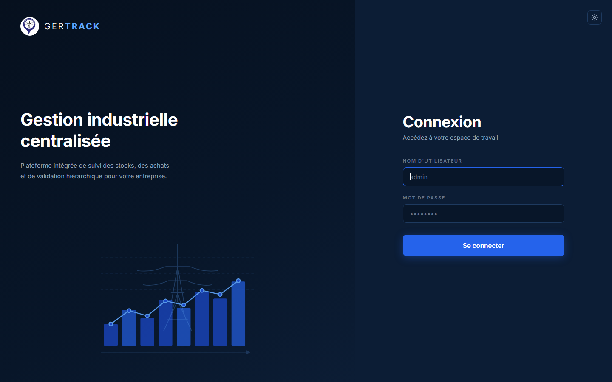
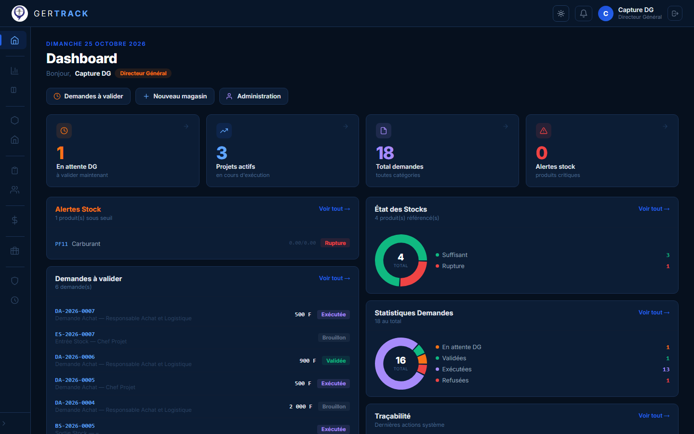
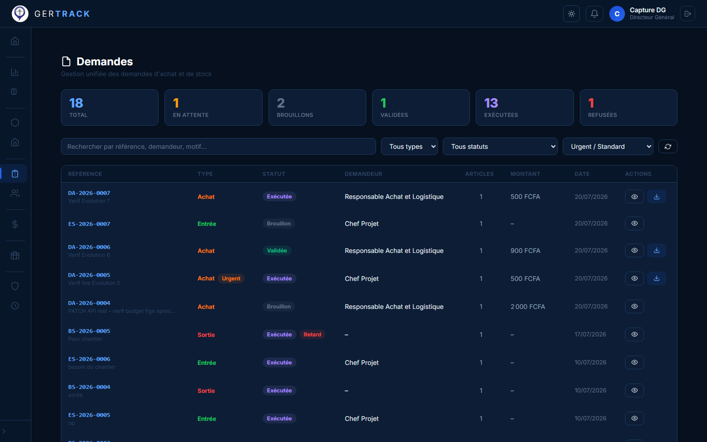
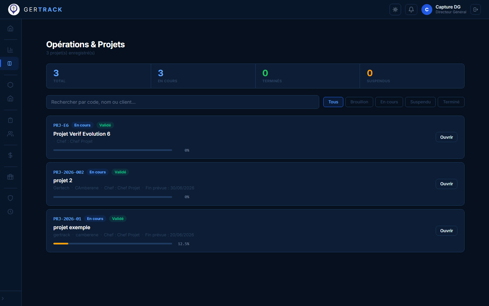
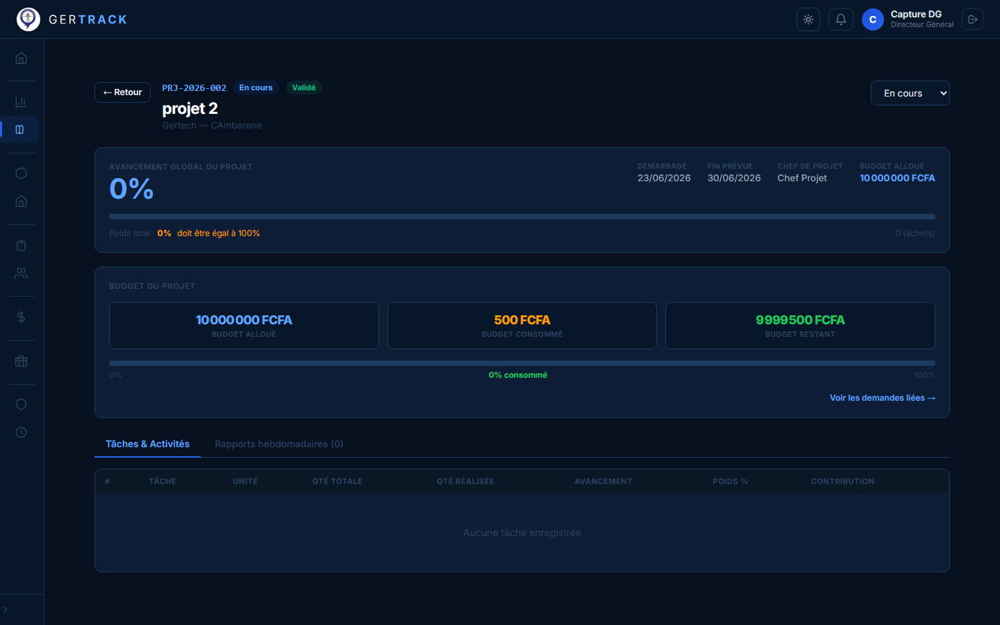
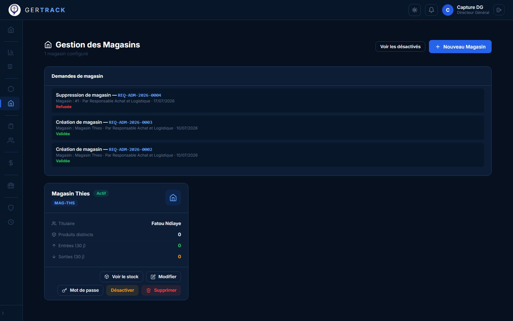
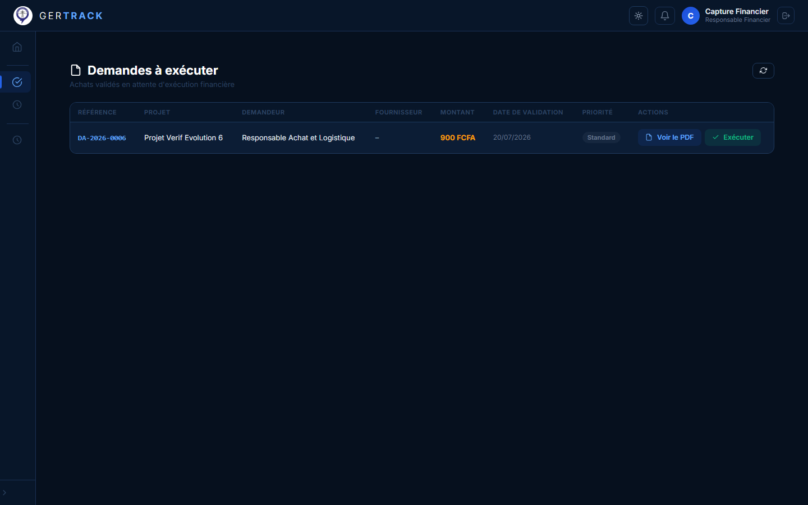
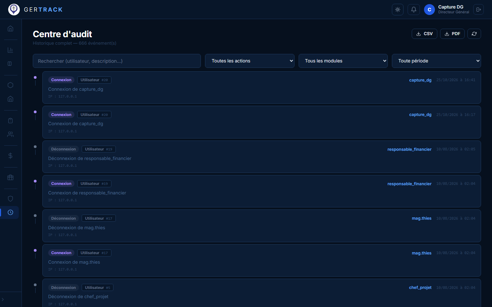
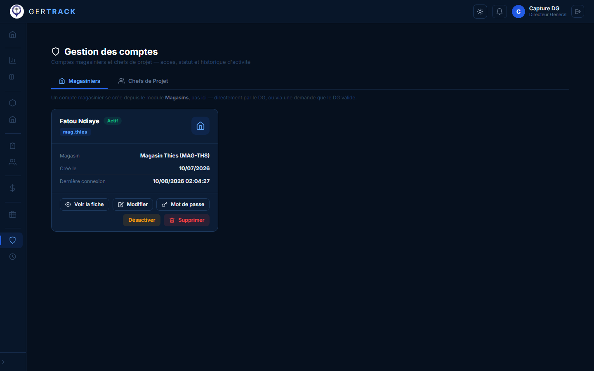

# GerTrack

Plateforme de gestion des achats, du stock et de la logistique pour projets :
demandes d'achat, circuit logistique configurable, budgets (projet et annuel
RAL), exécution financière, stock multi-magasins, notifications temps réel et
journal d'audit.

## Architecture

```
gertrack/
├── backend/          # API Django 4.2 + Django REST Framework (ASGI / Channels)
│   └── apps/
│       ├── accounts/       # Utilisateurs, rôles, audit
│       ├── products/       # Catalogue produits
│       ├── suppliers/      # Fournisseurs
│       ├── stock/          # Magasins et stocks
│       ├── operations/     # Projets, rapports hebdo, circuit logistique, budget RAL
│       ├── requests/       # Demandes d'achat et validations
│       └── notifications/  # Centre de notifications temps réel (Channels)
└── frontend/         # Application React 19 (Create React App)
    └── src/
        ├── design-system/  # Boutons, cartes, modales, badges… réutilisables
        ├── pages/          # Dashboard, demandes, stock, finances, projets…
        └── context/        # AuthContext (JWT), ThemeContext (clair/sombre)
```

## Rôles utilisateurs

| Rôle | Responsabilités principales |
|---|---|
| Directeur Général (DG) | Validation finale, budgets, déblocages, audit |
| Directrice des Opérations (DOP) | Validation des demandes, suivi des projets |
| Responsable Achat et Logistique (RAL) | Achats, circuit logistique, budget annuel |
| Chef de Projet | Demandes d'achat, avancement projet |
| Magasinier | Réception, stock, sorties |
| Responsable Financier | Exécution financière des achats validés |

Les permissions sont appliquées côté backend (querysets scopés, permissions DRF)
et côté frontend (garde de routes + sidebar par rôle).

## Fonctionnalités clés

- **Demandes d'achat** avec circuit de validation DOP/DG, urgence (course DOP/DG).
- **Circuit logistique** configurable par le RAL, avec suivi des retards.
- **Budgets** : budget projet immuable après création, budget annuel RAL avec
  seuil de blocage automatique et notification du DG.
- **Blocage automatique de projet** quand le budget déborde et que l'avancement
  est en retard sur le dernier rapport hebdomadaire.
- **Exécution financière** découplée de la réception magasin (deux statuts
  indépendants), protection contre la double exécution.
- **Notifications temps réel** (Django Channels, couche mémoire).
- **Génération de PDF** (reportlab) : bons de commande, rapports.
- **Audit** : journal des actions sensibles.
- **Thème clair/sombre** et design system maison côté frontend.

## Captures d'écran

<table>
  <tr>
    <td width="50%"></td>
    <td width="50%"></td>
  </tr>
  <tr>
    <td><em>Connexion</em></td>
    <td><em>Dashboard — vue DG</em></td>
  </tr>
  <tr>
    <td></td>
    <td></td>
  </tr>
  <tr>
    <td><em>Demandes d'achat et de stock</em></td>
    <td><em>Opérations &amp; projets</em></td>
  </tr>
  <tr>
    <td></td>
    <td></td>
  </tr>
  <tr>
    <td><em>Détail projet — avancement et budget</em></td>
    <td><em>Gestion des magasins</em></td>
  </tr>
  <tr>
    <td></td>
    <td></td>
  </tr>
  <tr>
    <td><em>Exécution financière — vue Responsable Financier</em></td>
    <td><em>Centre d'audit</em></td>
  </tr>
  <tr>
    <td colspan="2"></td>
  </tr>
  <tr>
    <td colspan="2"><em>Administration — gestion des comptes (DG)</em></td>
  </tr>
</table>

## Prérequis

- Python 3.12+
- Node.js 18+
- PostgreSQL (ou modifier `DATABASES` dans `backend/gertrack/settings.py`)

## Installation — Backend

```bash
cd backend
python -m venv .venv
.venv\Scripts\activate          # Windows  (Linux/Mac : source .venv/bin/activate)
pip install -r requirements.txt

# Configurer les variables d'environnement (créer un fichier .env) :
#   SECRET_KEY, DEBUG, ALLOWED_HOSTS,
#   DB_NAME, DB_USER, DB_PASSWORD, DB_HOST, DB_PORT,
#   CORS_ALLOWED_ORIGINS

python manage.py migrate
python manage.py createsuperuser
```

Lancement :

```bash
python manage.py runserver
# API sur http://localhost:8000  (serveur ASGI via daphne/channels)
```

## Installation — Frontend

```bash
cd frontend
npm install

# Créer un fichier .env :
#   REACT_APP_API_URL=http://localhost:8000

npm start
# Interface sur http://localhost:3000
```

Build de production : `npm run build` (sortie dans `frontend/build/`).

## Tests

```bash
# Backend (236 tests)
cd backend && python manage.py test

# Frontend
cd frontend && npm test
```

## Sécurité

- Authentification **JWT** (SimpleJWT) : access 8 h, refresh 7 jours,
  rotation des refresh tokens.
- `.env` jamais versionné (voir `.gitignore`) — fichier `.env.example`
  recommandé pour l'onboarding.
- CORS restreint aux origines configurées.

## Licence

Projet privé — tous droits réservés.
